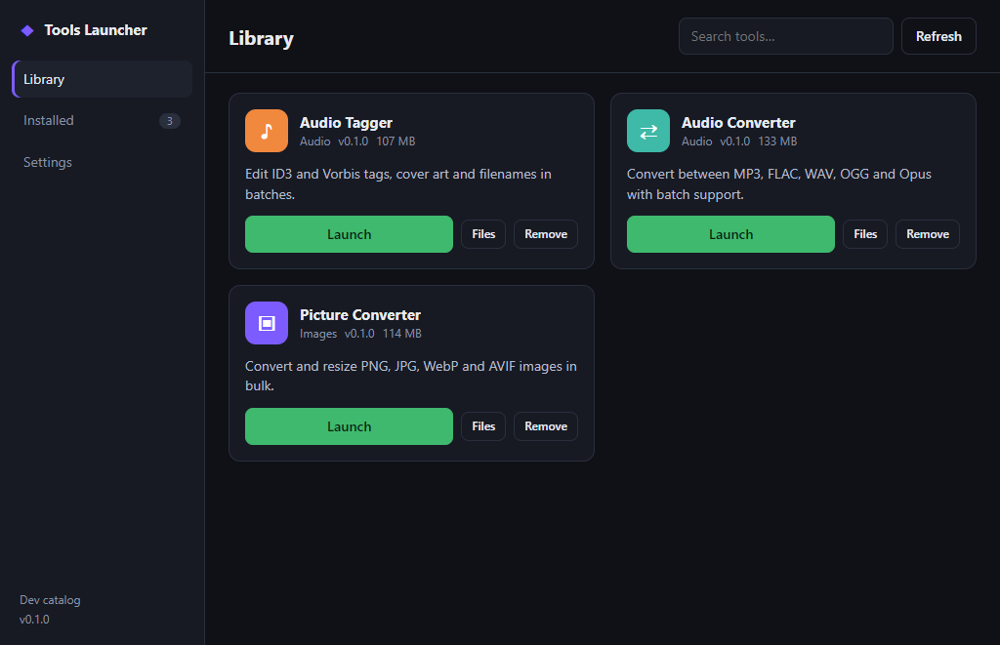
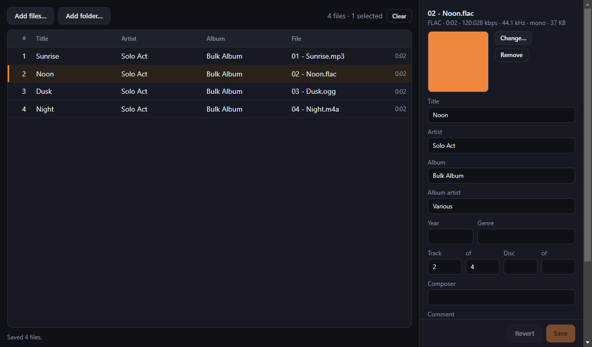
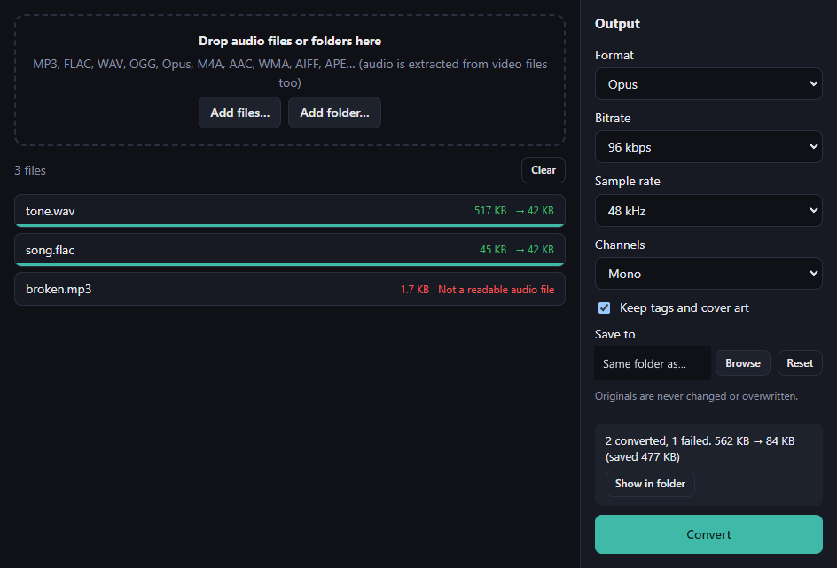
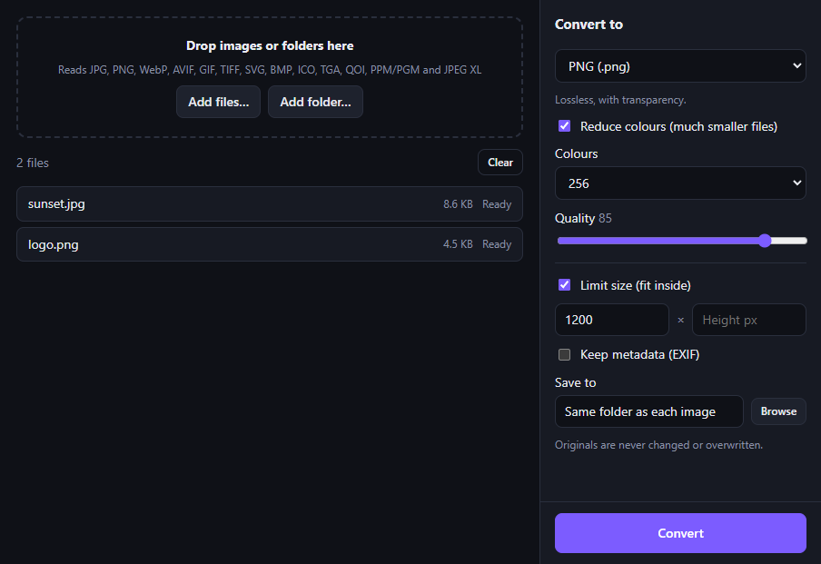
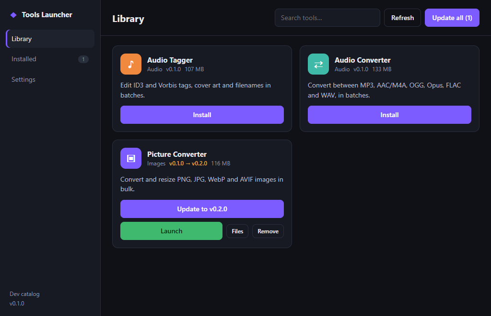

# Tools Launcher

A small desktop launcher (Windows and Linux) that installs, updates and starts a set of focused creative tools. Pick a tool, press **Install**, then **Launch**. Inspired by the ArtCraft launcher.



## Tools

| Tool | What it does |
|---|---|
| **Audio Tagger** | Edit tags and cover art for MP3, FLAC, OGG, Opus, M4A, WAV and more. Bulk edit many files at once, number tracks in list order, rename files from their tags. Every write is backed up, verified and rolled back on failure. |
| **Audio Converter** | Batch convert between MP3, AAC/M4A, OGG, Opus, FLAC and WAV (and pull the audio out of video files). Bitrate, sample rate, channels, keeps tags and cover art, parallel jobs with progress and Cancel. |
| **Picture Converter** | Batch convert and resize images between **14 formats**: JPEG, PNG, WebP, GIF, AVIF, JPEG XL, TIFF, PDF, BMP, ICO (multi-size), TGA, QOI, PPM and PGM. Per-format options (quality, lossless, progressive, palette, TIFF compression, icon sizes, background colour...). It also reads BMP, ICO, TGA, QOI, PNM and JPEG XL, so any of them can be converted to any other. |

<p>
  
  
  
</p>

All tools never overwrite your original files.

## Install

Download the latest build from the [Releases](https://github.com/xotwodfr/toolslauncher/releases/latest) page:

- **Windows:** `ToolsLauncher-Setup-<version>.exe` (installer) or `ToolsLauncher-Portable-<version>.exe`.
- **Linux:** `ToolsLauncher-<version>-linux-x64.AppImage` (`chmod +x`, then run) or the `.deb`.

Builds are **not code-signed**, so Windows SmartScreen will warn the first time. The Linux builds are produced and unit-tested by CI, but have **not yet been run on a real Linux desktop**: please report problems. The Linux tools start with `--no-sandbox`.

Tools are downloaded on demand (roughly 110-130 MB each) into your user data folder. The launcher checks each download's SHA-256 against the catalog and refuses anything that doesn't match, anything without a checksum, and (for hosted catalogs) anything that isn't served over HTTPS.

## Updating

Tools update from inside the launcher, using the releases published in this repository:

- When a newer version of a tool is published, its card shows **`v0.1.0 → v0.2.0`** and a full-width **Update to v0.2.0** button. **Update all** (top right) updates every tool that has an update.
- The launcher checks for updates when it starts; press **Refresh** to check right now.
- Updating a tool that is *running* is safe: the new version is installed next to the old one and is used the next time you start the tool; the old files are removed automatically (on the next update or launcher start).
  

- The launcher itself is not self-updating yet: to update it, install the newer build from the [Releases](https://github.com/xotwodfr/toolslauncher/releases/latest) page. Tool updates do not need a new launcher.

## Development

Requires Node 20+.

```bash
npm install
npm run dev     # builds stub tools + a dev catalog (using real built tool zips if present) and starts the launcher
npm test        # launcher core self-tests
npm start       # run with the real catalog/catalog.json
```

> npm 11 doesn't run dependency install scripts by default, which breaks Electron's binary download. If `node_modules/electron/dist` is missing after `npm install`, run `node node_modules/electron/install.js`.

### Tools

Each tool is its own small Electron app in `tools/<id>/`:

```bash
cd tools/audio-tagger          # or tools/picture-converter, tools/audio-converter
npm install
npm start                      # run it
npm test                       # core tests
npm run dist:win               # -> dist/<Name>-<version>-win-x64.zip  (dist:linux on Linux)
```

- Picture Converter: `sharp` handles JPEG, PNG, WebP, GIF, AVIF and TIFF; JPEG XL runs through libjxl compiled to WebAssembly (`@jsquash/jxl`); BMP, ICO, TGA, QOI, PNM and PDF are small pure-JavaScript codecs in `src/codecs/`. The format list and each format's options live in one registry (`src/formats.js`) that the interface builds itself from. `picture-converter --self-test=<result.json>` converts to every format and writes a report, which is handy for checking a packaged build. Its tests decode our encoders' output with ffmpeg when it is installed.
- Audio Converter bundles ffmpeg via `ffmpeg-static`: run `npm run setup` once after `npm install`.
- Audio Tagger's tests also use ffmpeg to make FLAC/OGG/Opus/M4A fixtures if it is installed; otherwise those are skipped.

To test a tool without publishing anything, build its zip; `npm run dev` in the repo root then offers it in the launcher (served from disk).

### Packaging the launcher

```bash
npm run dist:win     # installer + portable exe in dist/
npm run dist:linux   # AppImage + .deb (must run on Linux; CI does it)
```

### Releasing

`.github/workflows/build.yml` does everything from a tag:

1. Bump versions: the launcher in the root `package.json` (the tag must match it), and any tool whose code changed in its own `package.json`. A tool's version going up is what makes the launcher offer **Update** on the tool's card. To ship only a tool update, still bump the launcher's patch number so the tag has a new, matching version; users on an older launcher still receive the tool update, because the catalog is separate from the launcher.
2. Push a tag: `git tag v0.1.0 && git push origin v0.1.0`.
3. CI builds Windows and Linux on native runners, runs all four test suites, then generates `catalog.json` **from the real package files** (download URL, SHA-256, size, launch command) and attaches the installers, the tool zips and the catalog to a GitHub release. If any platform fails to build, nothing is published.

| Tag | Result |
|---|---|
| `v0.1.0` | Normal release. It becomes "latest", so the launcher's built-in catalog URL (`https://github.com/xotwodfr/toolslauncher/releases/latest/download/catalog.json`) now serves it. |
| `v0.1.0-rc1` | Prerelease. Never "latest", so users are unaffected. To try it, set **Settings → Catalog URL** to `https://github.com/xotwodfr/toolslauncher/releases/download/v0.1.0-rc1/catalog.json`. |

The launcher keeps the last good catalog on disk, so it still works offline (with a banner), and falls back to the small catalog bundled in the app (all tools "Coming soon") if it has never been online.

To build a catalog by hand from local zips: `node scripts/build-catalog.js --artifacts <folder> --base-url https://... --out catalog.json --require windows,linux`. For a single tool, `node scripts/register-tool.js <tool-id> --base-url https://...` rewrites that tool's entry in `catalog/catalog.json`.

## How it works

- `catalog/catalog.json` lists tools. Each has per-OS (`windows` / `linux`) `url`, `sha256`, `exec`, `kind` (`zip` or `file`) and optional `args`. A tool with no assets for your OS shows as "Coming soon".
- Install = download → verify the SHA-256 **of the file on disk** → extract to `tools/<id>/<version>` → record in `installed.json`. Zip entries that try to escape the install folder are rejected and truncated downloads are rejected. An update installs the new version next to the old one, then removes the old one on a best-effort basis (a running tool's files can't be deleted on Windows), so an update can never break a working install; leftovers are pruned on the next update or launcher start.
- A hosted catalog is treated as untrusted input: ids, versions, colours and text are validated and malformed entries are dropped, downloads must be `https://`, and a response over 1 MB or slower than 8 seconds is ignored.
- Layout: `src/main/core.js` (install/verify/extract logic, unit-tested), `src/main/main.js` + `preload.js` (Electron shell), `src/renderer/` (UI), `scripts/` (dev catalog, registration, icons, tests).

## Licence

The code in this repository is MIT licensed (see [LICENSE](LICENSE)). Built packages bundle third-party software, including a **GPL** ffmpeg build in Audio Converter: see [THIRD_PARTY.md](THIRD_PARTY.md).
